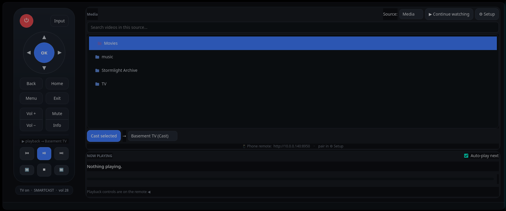
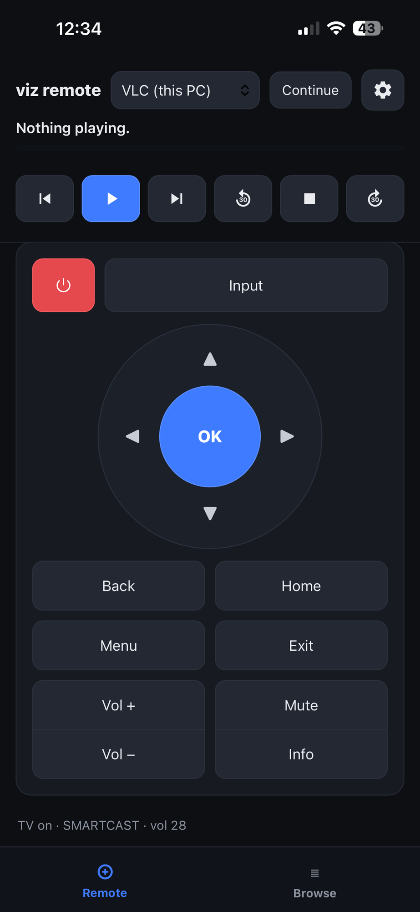
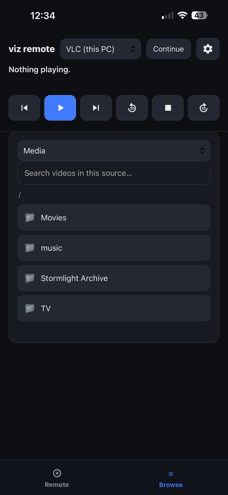

# vizgui

[](https://github.com/jm12460/VizGui/actions/workflows/ci.yml)

Cast local media to a SmartCast TV / Chromecast, or play it in VLC — with an
on-screen remote, a phone web-remote, continue-watching, subtitle / audio-track /
chapter selection, SMB network sources, and a first-run setup wizard. No account,
no subscription. Use it as a standalone PySide6 desktop app or connect to an
optional persistent headless casting server.



<p align="center">
  
  &nbsp;
  
</p>


## Headless server

VizGui can run without a desktop window:

    python -m vizgui.server

Configure a Chromecast target and enable the phone remote in the desktop
setup wizard first.

For persistent playback on Linux, see [server setup and recovery](docs/SERVER_SETUP.md).
The service renderer checks your selected Python and generates the correct unit
for a source checkout or installed package. Service installation and restarts
are separate manual steps; the app installer/updater never controls the service.

When a server is detected, the desktop offers:

- **Connect to Server:** Browse media and control server-owned playback.
- **Run Standalone:** Use local playback independently. Chromecast playback
  owned by the server is visible but read-only; local VLC remains independent.
- **Quit:** Exit without opening the desktop.

The headless server currently supports one playback-owning session.

In connected mode, **Sources** adds server-local folders or SMB shares and
removes existing sources without restarting playback. Source administration is
available on Linux only from a desktop running as the same OS user on the
server computer. The separate local channel does not grant administration to
paired phone clients; saved SMB passwords are never sent back in source lists.
Remote desktops can still browse and control playback. See
[server setup](docs/SERVER_SETUP.md#managing-server-sources) for details.

Connected desktops retry temporary connection failures automatically while
keeping the last playback display. A different server installation at the same
address requires closing and reopening the desktop. Updated servers identify
each process and reject commands intended for a previous process; older servers
support installation checks but cannot provide this restart safeguard. These
changes take effect when the server is next started; updating never restarts it.


## Features
- **Two playback targets:** cast to a Chromecast / SmartCast TV, or play on this
  PC in VLC (reuses a running VLC; controlled over its HTTP interface, or MPRIS
  for a VLC you opened yourself).
- **Plays anything on the TV:** H.264 mp4 is served directly; H.264 in mkv/etc. is
  live-**remuxed** (no re-encode); HEVC/x265 (incl. 10-bit) is **live-transcoded**
  to H.264 (hardware-accelerated where available, software fallback otherwise).
- **Subtitles, audio tracks & chapters:** choose a subtitle (embedded or sidecar
  `.srt`/`.ass` — burned in on Cast, native in VLC), switch the audio track, or
  jump to a chapter — from the desktop or the phone.
- **Continue watching:** remembers where you stopped, per file; resume from the
  desktop or phone. Works across direct cast, remux, live transcode, and VLC, and
  reconnects to an active cast if the app restarts. All local.
- **SmartCast remote:** power, input, a volume rocker, D-pad, menu/back/home +
  media transport, all in one panel. Pairs with a SmartCast TV.
- **Phone remote:** a mobile web page with a persistent now-playing/transport bar
  over Remote and Browse tabs, a Continue-watching view, and a settings sheet
  (auto-next, Cast rescan, source). Token-gated, paired by QR scan or a PIN.
- **Media sources:** local folders, mounted drives, or SMB shares mounted on
  demand (no root, no manual mounting).
- **Auto-play-next** through a folder, with Prev/Next skip.
- **Setup wizard:** tabbed (Sources / Cast & VLC / Phone Remote). Auto-discovers
  your TV, seeds your media folders on first run, and shows the firewall command
  matching your firewall — no config files to edit by hand.

## Appearance and accessibility

Use **Setup → Appearance**, or **Appearance** when connected to a server,
to choose system-default scaling or 100%, 125%, 150%, 175%, or 200%.
The display backend can be Automatic, Wayland, or X11/XWayland.

An inline warning identifies settings requiring a restart of the desktop GUI.
The headless server can continue running. If scaled dropdowns appear
misplaced under Wayland, try the X11/XWayland compatibility backend.

## Install (Linux)

Works on **Arch, Debian/Ubuntu, and Fedora** — the installer detects
`pacman` / `apt` / `dnf`. One command installs the dependencies, the
go-chromecast binary, the app, a `viz-gui` launcher, and an app-menu entry:

```
bash <(curl -fsSL https://raw.githubusercontent.com/jm12460/VizGui/main/install.sh)
```

Or clone and run the script:

```
git clone https://github.com/jm12460/VizGui.git ~/Projects/vizgui
bash ~/Projects/vizgui/install.sh
```

Then launch **vizgui** from your app menu (or run `viz-gui`). First run seeds your
media folders and opens the setup wizard, which auto-discovers your TV.

On **Fedora**, VLC and the full ffmpeg build live in [RPM Fusion](https://rpmfusion.org/)
(the installer notes this); enable it and `sudo dnf install vlc ffmpeg` for the VLC
target and all codecs.

### Updating an existing installation

If VizGui was installed using `install.sh`, update it with:

    bash ~/Projects/vizgui/install.sh --update

This updates the source checkout and refreshes the desktop launcher, PNG
icons, and KDE application cache when available. It skips dependency
installation and does not restart the headless server.

A plain `git pull` only updates the source files; it does not refresh the
installed desktop integration. If using a custom installation directory,
set `VIZGUI_DEST` to the existing checkout path.

### Other distros / manual
Install `python3`, `PySide6`, `ffmpeg`, `vlc`, `playerctl`, `gvfs` (SMB backend),
plus the [`go-chromecast`](https://github.com/vishen/go-chromecast) binary on your
`PATH`. Then `pipx install git+https://github.com/jm12460/VizGui.git` (which also
pulls the `qrcode` lib for pairing), or run `python -m vizgui` from a clone.
Missing tools are reported in-app.

## Platform support
**Linux** is fully supported. OS-specific behavior (data paths, SMB mounting,
process launching, subnet/firewall, hardware encoder, VLC location) lives behind
`vizgui/platforms/` behind a single contract, with `linux.py`, `windows.py`, and
`macos.py` backends. **Windows and macOS backends exist but are experimental and
untested on real hardware** — macOS should be close to complete; on Windows,
casting of H.264 mp4 works, but live remux/transcode (currently a bash wrapper)
still needs a Windows-native equivalent.

## Module layout
```
vizgui/
  app.py            entry point
  config.py         load/save/migrate config + shared active-cast state
  paths.py          dirs, tool paths, logging
  health.py         startup "which required tools are missing" check
  history.py        continue-watching + active-cast restore
  probe.py          audio tracks / subtitles / chapters (ffprobe)
  platforms/        OS integration (base.py contract + linux / windows / macos)
  playback/         playback-target contract + Cast / VLC adapters + media helpers
  smartcast.py      SmartCast TV keys, status, pairing
  chromecast.py     go-chromecast wrapper + device scan
  vlc.py            VLC control — HTTP (launched) + MPRIS (manual) backends
  transcode.py      live transcode/remux + subtitle-burn-in wrapper
  sources.py        local folders + on-demand SMB mounts
  webremote.py      phone web server + JSON API (+ remote.html)
  net.py            LAN IP / subnet detection
  helpers.py        time formatting, status parsing, cast planning, discovery
  qtasync.py        run work off the UI thread, deliver back on the main thread
  ui/               Qt GUI: theme, dpad, remote, dialogs, mainwindow
```
Settings live in `~/.config/vizgui/config.json` (chmod 600); logs in `~/.cache/viz-gui/`.

## Tests
```
python -m pytest -q   # requires pytest (e.g. `sudo pacman -S python-pytest`)
```
Tests in `tests/` use fake playback devices and temporary state, including
offscreen Qt checks, isolated loopback HTTP integration tests, service generation,
direct/remux/transcode restart recovery, receiver ownership, compatibility
fallbacks, and mocked hardware encoder selection. Some checks use Node.js or
FFmpeg when available. No real TV or live service is used.
Coverage includes status & cast
planning, Cast-device discovery, continue-watching + active-cast recovery, the
media probe (audio/subtitle/chapter parsing), config, the playback targets &
media helpers, VLC/MPRIS/Chromecast parsing, the transcode & subtitle-burn
wrapper, web browsing, subnet detection, the platform layer, and the health
check.

## Roadmap & releases
Headed toward easy, out-of-the-box install on Linux (AUR/Flatpak) and, later,
Windows and macOS. See [ROADMAP.md](ROADMAP.md) for the plan and
[CHANGELOG.md](CHANGELOG.md) for what's shipped.

## License
MIT — see [LICENSE](LICENSE).
